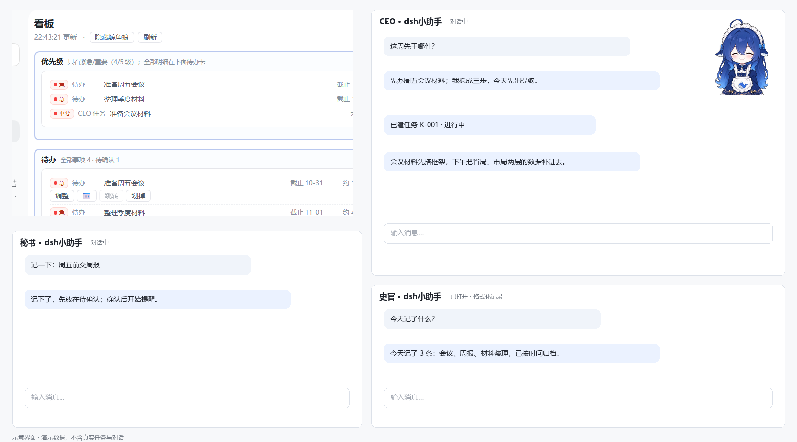

# dsh小助手（dsh-xiaozhushou）

> **给不会编程的人用的工作任务管理看板 + 共同成长的智能助手。**  
> 侧栏一块看板，屏幕边一只鲸鱼娘浮窗；记待办、看最急、盯提醒，不用写代码。

[](LICENSE)




> 截图为演示数据，不含真实任务与对话。

## 给谁用

这是给**不会编程的小白**用的：不用写代码、不用配环境，装上之后会说话就能用。

它把待办、优先级、提醒和任务收在一处；屏幕边的鲸鱼娘随时能喊出来，秘书、CEO、史官陪你聊、帮你判断、替你记录。所有数据都留在你自己电脑上。

## 最短路径（不会编程也能用）

1. 打开 DSH 的**插件**页，添加插件，输入 `dsh-xiaozhushou`，安装源选**官方源**；
2. 装完重启 DSH，点侧栏的 **dsh小助手**；
3. 在秘书框说一句：**记一下：周五前交周报**；
4. 看板里出现待办后，点 **确认**；
5. 之后每天打开看板看优先级，鲸鱼娘会在屏幕边提醒你；需要判断时对 CEO 说话即可。

不需要记命令、不需要改配置；下面的安装方式只是给愿意用命令行的人备用。

## 亮点：鲸鱼娘不是装饰

她常驻屏幕边，收起时只剩形象；点开是浮窗，直接显示最急的事和待办。可以拖到顺手的位置，右键隐藏或唤回；不想开整页看板时，点一下就能记一条、看今天最该干什么。


鲸鱼娘形象已经约了专业画师绘制，完整版浮窗 pet 正在制作，完成后上线；现在这版先用现有形象顶着。

## 路线与状态（作者本人也在摸索）

- 现在能用：工作任务看板、鲸鱼娘浮窗、待办台账、优先级、三角色聊天、定点提醒。
- 下一步会持续更新：把**记忆系统**和**伴生秘书**做得更合理，让它越用越懂你、跨会话不丢事。
- 本项目还在持续打磨，作者本人也在摸索中；欢迎提 issue 或反馈使用感受。

## 它是什么

dsh小助手是 DeepSeek Harness 的一个插件（bundle）。装上之后：

- **鲸鱼娘浮窗**：常驻屏幕边，收起只剩形象；点开看最急的事、记一条待办，拖拽换位置，右键隐藏/唤回；
- **侧栏工作任务看板**：待办、优先级、任务和三角色对话集中在一页；优先级卡只看紧急/重要，待办卡放全部事项和大概用时；
- **三个角色**：秘书简单陪聊、记待办；CEO 判断、拆解、派活与执行；史官只做结构化记录，给长期记忆供数据；
- **秘书代问 CEO**：只有你明确要“回复/结果/告诉我”时，秘书才追踪 CEO 回复并简短回传；等待状态只存内部文件，不占看板或浮窗空间；
- **长期记忆（简化版）**：`记忆/` 下四个 Markdown 由史官按周重写，秘书/CEO 只带一段摘要进对话；
- **所有数据都在本地**：台账、任务、审计、记忆都是普通 JSON / Markdown，可直接看、可备份。

## 安装（不会编程也能装）

> 插件零 npm 依赖；安装 npm 包需要联网；装完重启 DSH（或刷新页面）。

### 方式 A：一句话让 DSH 助手装（推荐，免命令行）

把下面这句发给 DSH 助手：

> 帮我安装 dsh-xiaozhushou 插件，npm 包名：dsh-xiaozhushou

成功标志：返回 `application: applied`；装完按提示重启 DSH。

### 方式 B：CLI（npm，推荐）

**桌面版：**

```sh
dsh plugin --profile desktop add dsh-xiaozhushou
```

**Web 版：**

```sh
dsh plugin --profile web add dsh-xiaozhushou
```

### 方式 C：CLI（GitHub 源码安装，网络能访问 GitHub 时）

```sh
dsh plugin --profile web add github:Flamencoff/dsh-xiaozhushou
```

### 方式 D：本地文件夹 / tgz（离线、调试用）

在 DSH 里让 Agent 执行：

```text
plugin_manager · action=install_bundle
target = <本仓库绝对路径或 tgz 路径>
```

> `--profile` 后面换成你自己的 profile 名（`web` / `desktop` / …）。
> 卸载：`dsh plugin --profile web remove dsh-xiaozhushou`（桌面版把 `web` 换成 `desktop`）。**卸载不删数据。**

## 日常操作（会打字就行）

1. 点侧栏 **dsh小助手** → 打开看板；
2. 在秘书框里说「**记一下：周五前交周报**」→ 待办里出现一条候选；
3. 点待办上的 **确认**，或对秘书说「**确认这条**」→ 开始参与提醒与优先级；
4. 想判断先干哪件，点「**问 CEO**」或对 CEO 说「**这周先干哪件**」；
5. 要开新任务会话，明确说「**开个任务会话：整理三季度材料**」→ 新会话标题是 `CEO · 整理三季度材料`，模糊指令不会自动新建；
6. 右键屏幕边的鲸鱼娘 → 刷新 / 唤出 / 隐藏。

## 数据与隐私

- 数据目录默认 `~/.dsh-session-steward/data`（Windows 为 `C:\Users\<你>\.dsh-session-steward\data`），可用配置 `dataDir` 改到别处；
- **史官默认开启，且默认读全部会话正文**（`enabled.historian: true` + `historian.scope.mode: all`）；只想读测试内容就按下面「开发 / 测试模式」切回 sandbox；
- 插件**不联网、无遥测**；只有你主动在聊天框说话时，内容才会交给 DSH 宿主的模型服务；
- 插件没有删除文件的能力；写操作只发生在数据目录（以及其上一级的 `史官/言行录`、`CEO/交接卡`）；
- 长期记忆在数据目录的 `记忆/` 下（四份 Markdown + `状态.json`），可直接打开看、也可手工改；手写内容放在 `<!-- AUTO:START -->…<!-- AUTO:END -->` 自动区外，周更不会覆盖；
- 找文件默认只按文件名、只在白名单目录里找，**默认不搜内容**。

完整说明见 [docs/PRIVACY.md](docs/PRIVACY.md)。

## 配置

改 `cordis.patch.yml`（或你 profile 的 patch）里的 `config`：

| 键 | 默认 | 说明 |
|---|---|---|
| `enabled.secretary` / `enabled.ceo` / `enabled.historian` | `true` / `true` / `true` | 三个角色开关；0.47.0 发布默认全开（史官可关） |
| `historian.scope.mode` | `all` | 发布默认读全部会话；`sandbox` 只读 `[实验]` 前缀 + 三个角色会话（开发测试用） |
| `historian.scope.prefixes` | `['[实验]']` | sandbox 模式的会话标题前缀 |
| `historian.schedule.enabled` | `true` | 每天记录 + 周五复盘的总开关 |
| `historian.schedule.dailyAt` | `'21:45'` | 每天静默记录时间（插件零 token） |
| `historian.schedule.weeklyAt` | `'21:45'` | 每周复盘时间（唤一次史官会话） |
| `historian.schedule.weeklyWeekday` | `5` | 复盘星期几：0=周日 … 5=周五 |
| `alarm.fixedTimes` | `['09:00','13:00','18:00']` | 每天定点提醒时间（HH:mm）；旧版口径可设 `['08:05','12:05','18:05']` |
| `alarm.policy` | `confirmed` | 确认制提醒：过期只在早、今天早/晚、明天只在晚；`classic` 恢复旧的“到点全列” |
| `alarm.quietHours` | `23:00–07:00` | 静默时段（照常算，不弹） |
| `dataDir` | 用户目录默认 | 数据目录；写了就优先用它 |
| `pet.enabled` | `true` | 鲸鱼娘浮窗 |
| `find.allowedRoots` | `[]`（数据目录上一级） | 允许被「找文件」搜索的根目录 |
| `find.content` | `false` | 是否允许按内容搜索（隐私默认关） |

### 开发 / 测试模式（史官只读测试会话）

本地开发、演示或涉密环境，不想让史官读真实会话，把 patch 里的 `historian.scope` 改回 sandbox：

```yaml
        enabled:
          historian: true          # 也可以 false，直接关掉史官
        historian:
          scope:
            mode: sandbox
            prefixes:
              - '[实验]'
```

sandbox 下只读两类会话：标题以 `[实验]` 开头的测试会话，以及三个角色自己的会话（`dsh小助手 · 秘书 / CEO / 史官 对话`）。
真实工作会话会被跳过并在结果里计数（`filteredByScope`）；想恢复读全部就把 `mode` 改回 `all`。

## 接口与网络边界（27 条本地回环路由）

- 插件向 DSH **本机 Web 服务**注册 27 条 HTTP 路由，全部挂在 `/api/dsh-xiaozhushou/*` 下，地址形如 `http://127.0.0.1:<端口>/api/dsh-xiaozhushou/health`；
- 它们是**回环接口**：只随 DSH 自己的 Web 服务监听 `127.0.0.1`（localhost），插件**不另开端口、不监听 `0.0.0.0`、不对外提供网关/代理**；
- 端口每次启动会变，脚本调用先探 `/health`；写接口只接受 `POST`，并拦截跨源提交（`Origin` 与 `Host` 不一致直接 403）；
- 也就是说：别人在另一台机器上**连不到**这些接口；它们只服务本机页面上的看板/浮窗。

## 兼容性

- **DSH**：适配 **0.2.1-rc.3 ~ 0.2.1-rc.5**（`engines.dsh = ">=0.2.1-rc.3 <0.3.0"`；0.3 以上未验证）；
- **Node**：≥ 20；
- **平台**：**Windows 10 / 11 已适配**；Linux、macOS、鸿蒙（HarmonyOS）**没有做适配**，未验证；
- **依赖**：零 npm 依赖；客户端只使用 DSH 宿主提供的 `react`。

## 自测与自检

```sh
node test/harness.mjs          # 211 项自测
node scripts/check-release.mjs # 发布自检（版本/包体/个人痕迹/文档）
node scripts/check-imports.mjs # 模块依赖体检（无循环、无外部依赖）
```

## 已知限制

1. **角色聊天必须先绑定真实会话**：首次启动会自动建好三个角色会话（已有则复用）；若被删，重启 DSH 会重新建；仍不可用时看 `/health` 与数据目录 `维修站.md`；
2. 长期记忆是**简化版**：四份 Markdown 由规则生成（台账/任务板统计 + 角色对话与言行录摘句），不做语义检索；周更只重写 `<!-- AUTO:START -->…<!-- AUTO:END -->` 自动区，你在自动区外手写的内容会保留；周更由「跑一次史官」触发；
3. 端口每次启动会变，写脚本调用时先探测 `/health`；
4. 没有独立的设置页 UI，配置改 `cordis.patch.yml`；
5. 「开新会话执行」与按钮开新会话共用限频（每小时最多 4 个）；权限审批由 DSH 宿主在**新会话里**弹窗，插件不代点；
6. 仅中文界面文案（英文 locale 只有标题与描述）。

## 回退与卸载

- **卸载**：插件管理器 `remove_bundle`，或 `dsh plugin --profile web remove dsh-xiaozhushou`（桌面版把 `web` 换成 `desktop`）；**卸载不删数据**。
- **回退**：装回上一个 tag 的版本即可（v0.47.3 / v0.47.2 / v0.47.1 / v0.47.0 / v0.46.0 都有发布包）；数据在 `~/.dsh-session-steward/data`，换版本不会丢。
- **彻底清掉**：先备份数据目录，再删 `%USERPROFILE%\.dsh-session-steward\`（指针与数据）；插件本体由 profile 卸载。
- **出问题先看**：`GET /api/dsh-xiaozhushou/health`（ok/version/degraded），以及数据目录下的 `维修站.md`（插件自检生成的诊断）。

## 仓库结构

| 路径 | 作用 |
|---|---|
| `index.js` | 宿主半入口：27 条 HTTP 路由 + 角色/工具/定时器注册 |
| `client.js` | 客户端半：侧栏图标 + 整页看板 + 浮窗 |
| `core/` | 39 个纯逻辑模块（台账、提醒、史官、长期记忆、任务板、CEO 执行、模型调用等） |
| `roles/` | 三个角色 preset 与身份提示词 |
| `locale/` | 中英文文案 |
| `test/harness.mjs` | 零依赖自测台（211 项） |
| `scripts/` | 发布自检、依赖体检、市场索引生成 |
| `docs/` | 架构、发布流程、隐私说明、截图 |

架构与「模块如何解耦、分支怎么开」见 [docs/ARCHITECTURE.md](docs/ARCHITECTURE.md)；
Git 协作规范见 [CONTRIBUTING.md](CONTRIBUTING.md)。

## 许可

代码 MIT（见 [LICENSE](LICENSE)）。鲸鱼娘等素材来源见 [THIRD_PARTY_NOTICES.md](THIRD_PARTY_NOTICES.md)。

<!-- 被 dsh-plugin.org 收录后，把下面链接里的 owner/slug 换成详情页地址即可
[](https://dsh-plugin.org/plugins/Flamencoff/dsh-xiaozhushou)
-->
